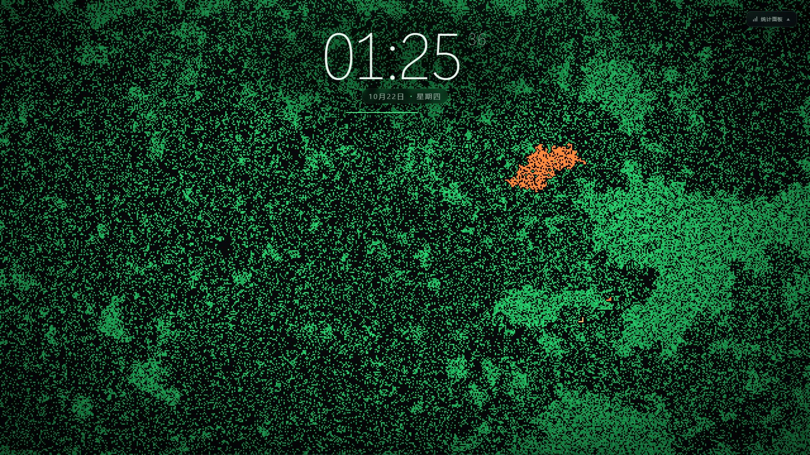

# Ember Field

基于 Canvas 的森林火灾元胞自动机壁纸，可直接导入 Wallpaper Engine。绿色细胞持续生长，闪电随机点燃，火焰以分形方式蔓延；顶部是本地时钟，底部面板用双对数坐标记录火灾规模的幂律分布。



## 功能

- **火灾模拟**：生长、随机点火、逐帧平滑蔓延 / 瞬间蔓延、逐细胞独立燃烧动画，参数均可实时调整；可选的循环边界让火灾与鼠标点火在画面四边环绕相连。
- **本地时钟**：顶部大号数字时钟，包含时:分、低干扰秒数、分钟进度条、中文日期与星期。每秒平滑更新。
- **统计面板**：双对数分箱密度散点图 / 密度直方图可切换，附带幂律拟合，显示 `α`、`R²`、样本数与最大火灾规模。散点、直方图和拟合线共用同一套 `1.5×` 几何分箱与密度纵轴。
- **两套主题**：
  - 霓虹（默认）：近黑背景、荧光绿生命体、琥珀到绯红的火焰，玻璃拟态面板。
  - 终端：暖色复古 CRT 风格，扫描线、荧光绿与 Orbitron 时钟。
- **柏林噪声配色**：存活细胞的颜色不再逐格哈希取色，而是读一张启动时由二维柏林噪声（fBm + 直方图均衡）一次性生成的颜色索引表，整片森林呈现大块连续的"地形"色块；同一次运行内颜色分布固定不闪烁，可在面板或 WE 属性里切回哈希散点配色。
- **鼠标交互**：在画面上点击或拖拽即可点燃圆形区域内的存活细胞，并出现点火波纹；启用循环边界时，靠近边缘的点火圆会环绕到对侧。
- **参数面板**：主题、柏林噪声配色、生长率、起火率、蔓延速度、燃烧时长、细胞尺寸、帧间隔、瞬间蔓延、循环边界、图表缩放、直方图模式、时钟与鼠标点火开关。
- **状态持久化**：主题与参数保存在 `localStorage`，刷新后保持。
- **Wallpaper Engine**：附带 `project.json`，可在编辑器中直接调整主题、配色方式、时钟、循环边界、细胞尺寸、生长率、起火率、蔓延速度、燃烧时长、帧间隔、图表缩放、直方图模式等属性；所有滑块旁都带有可直接输入数值的输入框。

## 操作

| 操作 | 说明 |
| --- | --- |
| 点击右上角「统计面板」 | 展开 / 收起面板（按钮固定在右上角，不会被任务栏遮挡） |
| 在画面点击或拖拽 | 点燃细胞 |

URL 调试参数：`?panel=1` 默认展开面板；`?theme=terminal` 强制终端主题；`?debug=1` 暴露 `window.__emberField` 调试接口。

## 统计图怎么读

- 横轴：一次火灾燃烧的细胞总数 `s`（对数刻度）。
- 纵轴：概率密度 `P(s)`（对数刻度）。每个对数箱的密度 = 箱内火灾次数 / 箱宽。
- 分箱：从 1 开始，边界逐次乘 `1.5` 并取整，跳过零宽箱。
- 散点模式：每个非空对数箱一个琥珀色圆点，横坐标是箱内按次数加权的平均规模，点越大表示箱内次数越多。
- 直方图模式：同一套对数箱，柱高表示该箱的密度，而不是原始次数。
- 绿色直线：对 `x ≥ 4` 的分箱密度做无加权最小二乘拟合。对于 `P(s) ∝ s^-α`，密度序列的双对数斜率就是 `-α`，因此 `α = -slope`。
- `α`：幂律指数；`R²`：对数密度上的无加权拟合优度。

> 火灾规模采用「本次火灾中所有被点燃的细胞数」，包含火种与蔓延到的细胞。

## 开发

需要 Node.js 与已安装的依赖：

```bash
npm install
npm run build      # 输出 js/main.js
npm run watch      # 开发时监听
```

Windows 也可以直接运行：

```powershell
.\build.ps1
```

入口是 `index.html`，源码在 `ts/`，样式在 `css/style.css`。

## 导入 Wallpaper Engine

1. 在 Wallpaper Engine 编辑器中点击「创建壁纸」，把项目根目录的 `index.html` 拖入。
2. 编辑器会读取同目录的 `project.json`，右侧出现主题、时钟、模拟参数等可调属性。滑块开启 `editable`，既可在右侧直接输入精确数值，也可拖动滑条。
3. 如果修改了 TypeScript 源码，先执行 `npm run build` 生成 `js/main.js` 再导入。

### WE 属性一览

| WE 属性 | 控制面板对应 | 类型 / 范围 |
| --- | --- | --- |
| `theme` | 主题 | combo：霓虹 / 终端 |
| `show_clock` | 显示时钟 | bool |
| `mouse_ignite` | 鼠标点火 | bool |
| `loop_map` | 使用循环网格 | bool |
| `skip_spread` | 瞬间蔓延 | bool |
| `cell_size` | 细胞尺寸 | slider：2–6 px |
| `p_revive` | 生长率 | slider：1e-5–0.1 |
| `p_ignite` | 起火率 | slider：1e-8–1e-4 |
| `fire_spread_speed` | 蔓延速度 | slider：1–20 层/周期 |
| `burn_status_time` | 燃烧时长 | slider：1–20 帧/段 |
| `tick_time` | 帧间隔 | slider：8–50 ms |
| `chart_scale` | 图表缩放 | slider：0.5–1.5 |
| `chart_histogram` | 直方图模式 | bool |
| `perlin_color` | 柏林噪声配色 | bool |

## 文件结构

```text
index.html            页面结构
project.json          Wallpaper Engine 工程与用户属性
css/style.css         主题、时钟、面板与响应式样式
css/font.css          Orbitron 字体声明
font/                 Orbitron 字体文件
ts/main.ts            入口与主循环、交互、WE 属性桥接
ts/FireSimulate.ts    元胞自动机与火灾统计
ts/SimulatorDrawer.ts 主画面差分绘制
ts/StatisticsDrawer.ts 双对数图表（散点 / 直方图）与幂律拟合
ts/Clock.ts           时钟
ts/ControlPanel.ts    参数面板
ts/settings.ts        默认参数、持久化与格式化
ts/wallpaperProperties.ts  WE 用户属性到 Settings 的映射
ts/theme.ts           两套主题的模拟与图表调色板
ts/tools.ts           CSS 颜色解析、柏林噪声与颜色索引表生成
js/main.js            esbuild 构建产物
preview.jpg           商店 / 编辑器预览图
```
